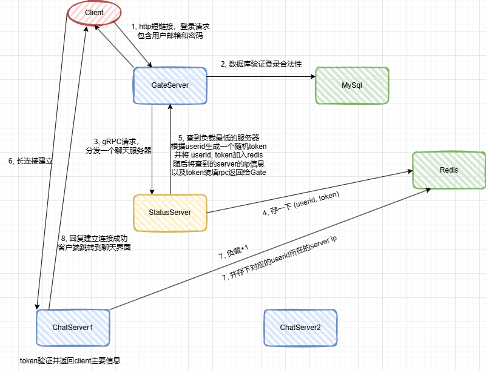
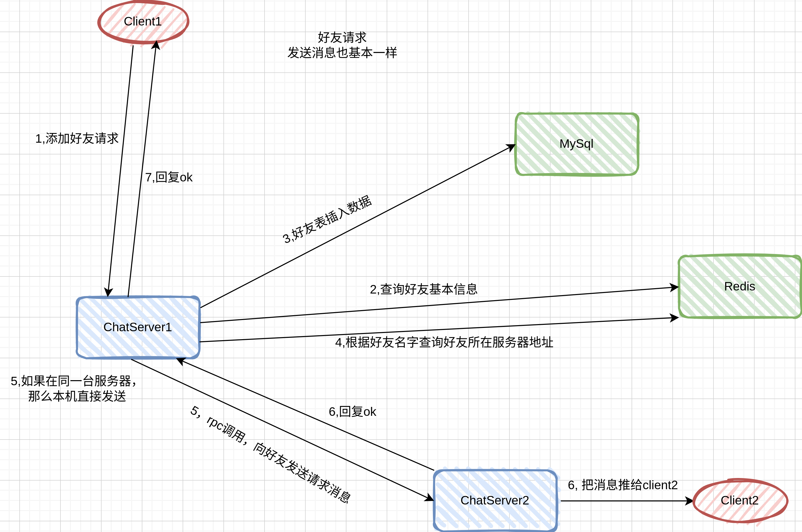

# 🌟 CChat 项目说明

## 📢 声明

本项目为[恋恋风辰](https://llfc.club/)全栈聊天系统的 Linux 复现版本，已在 **Ubuntu 22.04** 环境完整验证运行。  
Windows 平台不保证完全兼容，但开发过程中已在 Windows 上实现并完成初步调试，随后移植至 Linux 并修复相关问题。

🔍 如在其他平台遇到问题，欢迎提交 Issue 反馈。

🎯 **恋恋风辰的全栈聊天系统**
基于 C++11/QT5，结合 Redis、MySQL、gRPC 等技术栈打造的聊天应用，支持用户登录、好友管理、消息收发等核心功能。

## 📦 项目依赖

请在编译前确保以下第三方库已正确安装：

```shell
# Redis 客户端库：hiredis
sudo apt-get install libhiredis-dev

# MySQL Connector/C++ 客户端库
sudo apt install default-libmysqlclient-dev

# Protobuf & gRPC
# 参考教程：https://llfc.club/category?catid=225RaiVNI8pFDD5L4m807g7ZwmF#!aid/2eIaoR0NBxxirmXKdzcke9vJxmP

# JSON 解析库：jsoncpp 1.9.2
# 下载源码后进入 build 文件夹执行：
cmake ..
make -j6
sudo make install

# Boost C++ 库
sudo apt-get install libboost-dev libboost-test-dev libboost-all-dev
```

## 🛠️ 编译方法

项目需要 **C++20** 标准支持：

```shell
bash build.sh Debug    # 生成 Debug 版本
bash build.sh Release  # 生成 Release 版本
```

## 🚀 运行方法

编译完成后，进入 `bin/` 目录，找到对应的可执行文件直接运行即可：

```shell
cd bin
./CChatServer         # 启动聊天服务端
./CChatClient         # 启动聊天客户端
```

## 🔑 用户登录流程



## 🤝 好友请求与聊天流程



---

## 📌 其他说明

- 本项目仅供学习、研究使用，欢迎提交 Issue 或 PR 🙌  
- 更多技术细节与设计理念，请关注[恋恋风辰](https://llfc.club/)  
- 如对项目中的技术细节存在疑问，或您是 C++ 初学者，欢迎访问 [恋恋风辰的 B 站空间](https://space.bilibili.com/271469206)，
  该项目配套完整且详细的视频教程，并包含 Boost.Asio 等相关技术的专门讲解。
